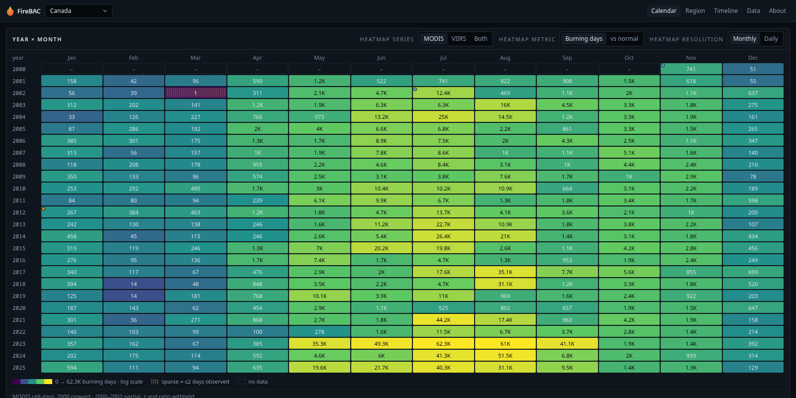
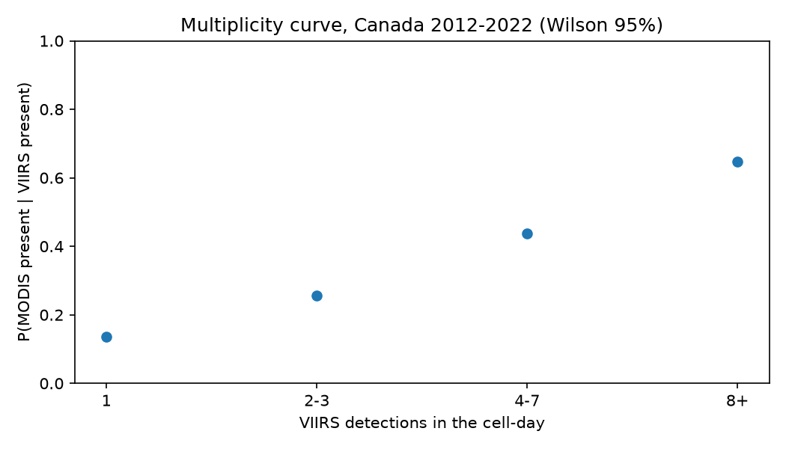
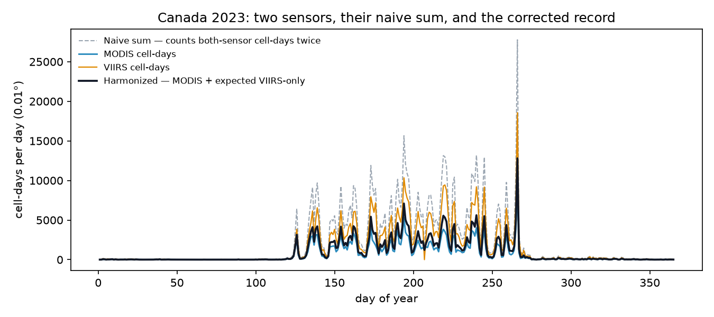

# FireBAC — a burning activity calendar

A 26-year burning activity calendar, built from NASA MODIS and VIIRS active-fire detections,
with a published correction for the difference between the two sensors.
Currently with data covering Canada only. Argentina and USA soon to come.

## Website

- **Calendar** — 26 years × 12 months of burning days, monthly and daily, with a log-z view
  against the 2012–2022 median. Two series are published and never spliced: MODIS
  (2000–2025) and harmonized (2012–2025).
- **Region** — draw an area, compare raw MODIS, raw VIIRS and the corrected estimate, and
  download the detections behind the search.
- **Timeline** — every satellite pass that saw a place, as a log.



## Run it

Requires Python 3.12 with `uv`, and `bun` for the web app.

```bash
uv sync
make fetch          # NASA FIRMS country CSVs, ~630 MB, sequential
make artifacts      # calendar, grid, model, hotspots
make density        # 0.1° raster and 0.01° cell-days
make tiles          # zoom tiles
make passes         # timeline aggregates
make detections     # raw rows for the AOI table

cd web
bun install
bun run dev         # http://localhost:5173
bun run build       # static output in web/dist
```

`make artifacts` accepts `REGION=CA` (the default). The site is static: no backend, no
database, no auth.

## Notebooks

- `notebooks/01_cross_sensor.ipynb` reproduces the cross-sensor ratio and the multiplicity correction.
- `notebooks/02_calendar.ipynb` reproduces the calendar and the 2023 anomaly.

<p>
  
</p>



`make lab` opens them in Jupyter Lab.

Data: NASA FIRMS country archive. Code: Apache-2.0, see `LICENSE`.
