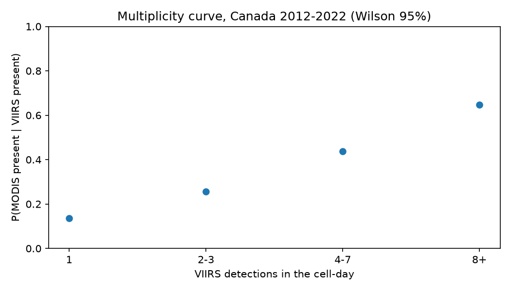
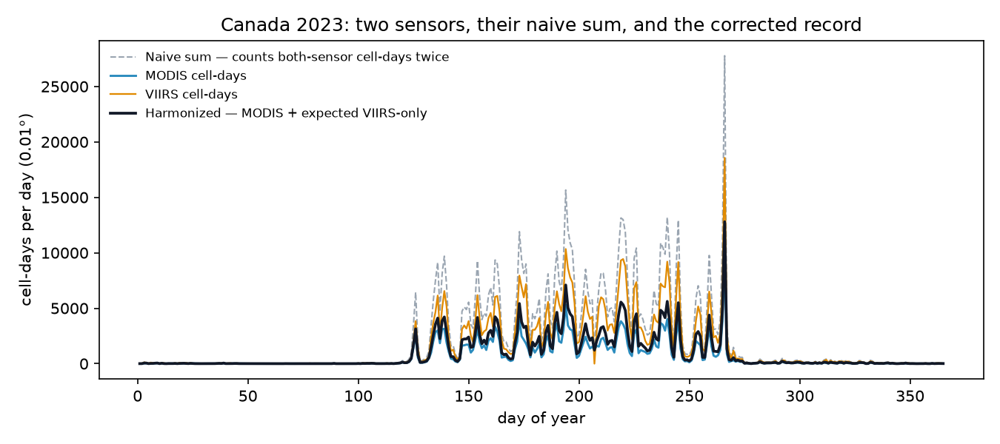

# Notebooks

- `01_cross_sensor.ipynb` answers how much of the VIIRS/MODIS gap is double counting and calibrates the multiplicity correction. Run: `uv run jupyter nbconvert --to notebook --execute --inplace notebooks/01_cross_sensor.ipynb`
- `02_calendar.ipynb` answers how unusual 2023 was against 2012–2022 and why 2000–2002 are not comparable. Run: `uv run jupyter nbconvert --to notebook --execute --inplace notebooks/02_calendar.ipynb`

Both read `data/raw/` and assert their numbers against `web/public/artifacts/`. They write their figures to `figures/`, which is where the two images below come from — re-running a notebook regenerates them.

## The multiplicity curve

`P(MODIS present | VIIRS present)` rises from 0.14 for a single VIIRS detection in a cell-day to 0.65 for eight or more. That curve is the correction.

## What the correction does to a year

Canada, 2023, daily. MODIS and VIIRS counted separately, their naive sum, and the corrected
record. The naive sum treats two instruments as one unit and counts every both-sensor
cell-day twice — it is not an upper bound, and the corrected line is not the midpoint.

